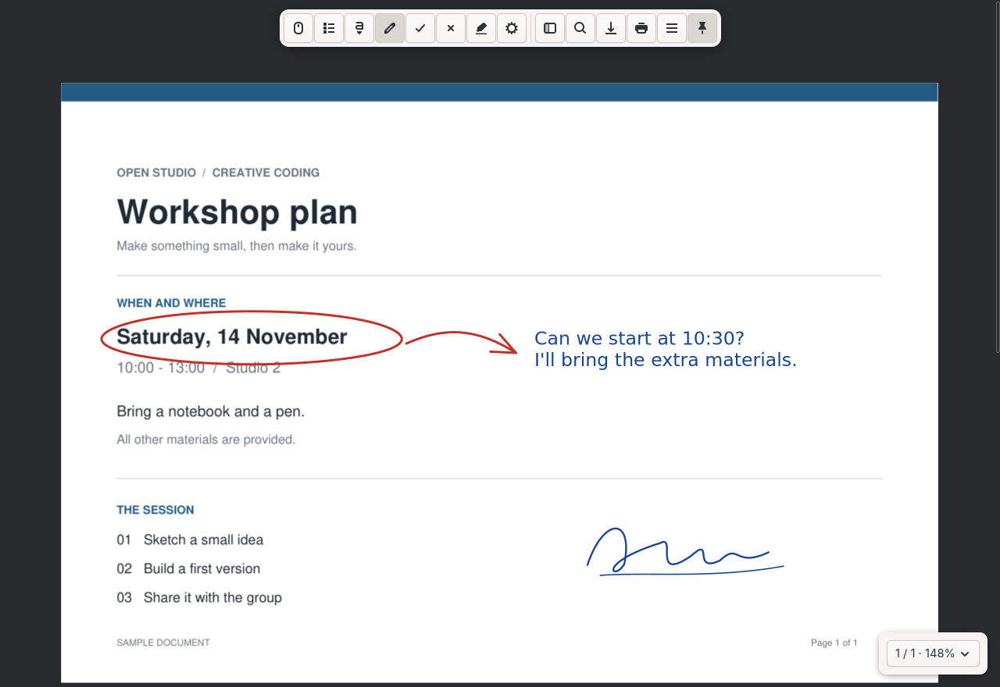
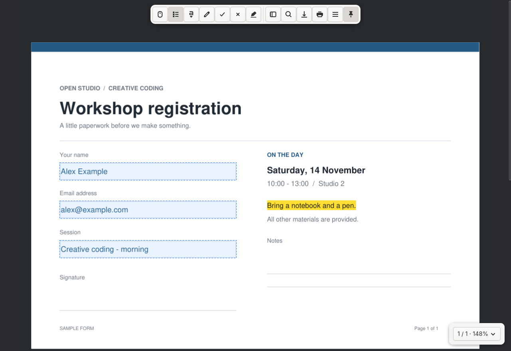

# PDF Marker

PDF Marker is a small native Linux app for reading PDFs and doing the things to them that usually involve a printer, a pen and a scanner (or a $5+/month SaaS subscription): filling in forms, ticking boxes, writing in the spaces without computerised form fields, and signing at the bottom.

I wanted something that could do all of this in a native GTK window with simple, intuitive UX. Some other apps do it, but I wasn't satisfied with any of them – see [prior-art.md](docs/prior-art.md).


*A text box on a document with no form fields, selected to show its resize handle. The circle, arrow and signature were drawn freehand.*

## Running it

PDF Marker needs Python 3.10 or later, GTK 4.10 or later, PyGObject, Pycairo, the GI Cairo bridge, `venv` and a Linux desktop running Wayland or X11. Once those are in place, you can start it from this directory:

```sh
./run.sh
./run.sh /path/to/form.pdf
# After installation:
pdf-marker /path/to/form.pdf
```

The launcher checks that GTK is available, then creates a local `.venv` with access to system site packages so that it can use your distribution's Python bindings for GTK and Cairo. It installs the Python PDF libraries with pip, but it will never install system packages – that part is up to you. On Debian and Ubuntu, install `python3-gi python3-gi-cairo python3-cairo gir1.2-gtk-4.0 python3-venv` with your package manager (your release will need to ship GTK 4.10 or later). On Arch, install `gtk4 python-gobject python-cairo`. To see whether everything is in place without changing anything, run `./check-gtk.sh`.

The launcher uses `/usr/bin/python3` by default. If you'd rather it used a different system Python, set `PDF_MARKER_PYTHON`.

To add PDF Marker to your application menu and to the "Open With" options for PDF files, run the installer:

```sh
./install.sh
```

This installs to `~/.local`, so it doesn't need root, and it won't make PDF Marker your default PDF viewer, though you can do that yourself afterwards. The installed command and menu entry both point back to this directory, so leave it where it is. To uninstall, delete `~/.local/bin/pdf-marker` and `~/.local/share/applications/pdf-marker.desktop`.

## Reading

You can open a PDF from within the app, by passing its path on the command line or by dropping it onto the window. Recent files are listed on the start screen and under **Menu → Open recent**, and each one reopens where you left it, at the same page, zoom, rotation and layout.

The toolbar stays hidden until you need it. Move the pointer to the top edge of the document area, click the small handle there or press F10, and it will slide down. Click the pin button to keep it open, and PDF Marker will remember that you did.

Scrolling is continuous, with the mouse wheel, touchpad, scrollbar, arrow keys or Space. Page Up, Page Down, Home and End jump between pages. Ctrl+wheel zooms around the pointer, and dragging with the middle mouse button pans. Pages are rendered in the background, and only images of the visible pages are kept in memory.

The indicator in the bottom-right corner holds the page list, zoom (fit width, fit page or a fixed level), page layout (single pages, two pages side by side, or two pages with the cover on its own), rotation, full screen (F11) and presentation mode (F5). R and Shift+R also rotate the view – this only changes how pages are displayed, never the file itself. In presentation mode, click or use Space or the arrow keys to move between pages, and press Escape to leave.

Select (V) is the default tool. With it, you can drag across text to select it, even across pages, or double-click to select a word, triple-click for a line, or press Ctrl+A for everything. Ctrl+C copies. Clicking a link, note or form field with Select will use it.

Ctrl+F searches the document and highlights every match. Enter or F3 moves to the next match, and Shift+Enter or Shift+F3 to the previous one.

Links within the document jump to their targets, web and email links open in your browser or mail app, and links to another local PDF open that PDF. Links that would run a program or script (yes, PDFs can do that) or point to any other kind of address are blocked.

F9 opens the sidebar, which shows the document outline, any embedded attachments (which you can save) and the text of the current page, in a view that screen readers can read.

Click a sticky note, highlight or other annotation to read its text, edit it or delete it. Alt+Enter shows the document's properties: metadata, page size, PDF version, encryption and form type.

## Filling and marking

<dl>
<dt>Fill fields (F)</dt>
<dd>

Highlights only the form fields and lets you fill them in. Clicking a field with Select works too. Text fields, checkboxes, radio buttons, dropdowns and list boxes are all supported, and a field that appears more than once updates everywhere at once.

Many forms made in Acrobat rely on its standard scripts to format and check what you type: numbers, currencies, percentages, dates, times and special formats like phone numbers, along with range validation and calculated totals. PDF Marker implements these natively, including `AFSimple_Calculate` and simplified field notation, rather than running them as JavaScript. For reasons of security and sanity, custom JavaScript is never executed.

</dd>
<dt>Text box (T)</dt>
<dd>

Type directly on the page, whether the document has form fields or not. Drag out a rectangle, or just click to place a default box. Text boxes start compact, grow downwards as you type and resize to fit their text when you're done. Click outside the box or press Ctrl+Enter to finish, or press Escape to cancel the current edit. To edit a text box again, click it with the Text box tool or double-click it with Select. Size and Ink also work on selected text. The editor and the saved PDF use the same vector text layout, with the same line wrapping and font metrics, so what you see while typing is what ends up in the file.

</dd>
<dt>Draw (D)</dt>
<dd>

For signatures and any other freehand marks, such as circling details, drawing arrows or sketching wherever you need to. Each stroke, from mouse-down to mouse-up, is a separate mark that can be undone, moved or deleted.

</dd>
<dt>Tick (K) and Cross (X)</dt>
<dd>

Place a mark wherever you click. Size and Stroke control its dimensions and line width, and Ink sets the colour of new marks.

</dd>
<dt>Highlight (H)</dt>
<dd>

Marks text that's already on the page. Drag across it, or right-click some selected text and choose **Highlight**. Highlights are saved as standard PDF highlight annotations, and you can change their colour with the settings button.

</dd>
<dt>Select (V)</dt>
<dd>

As well as selecting text, Select moves the marks you've added. You can drag any text box, drawing, tick or cross, including onto a different page, and Ctrl-click to select several marks and move or delete them together. Dragging the handle at the bottom-right of a selected text box resizes it and reflows its text. To remove selected marks or highlights, or the selected note, press Delete, choose **Delete selected** or use the right-click menu. Ctrl+C copies selected marks and Ctrl+V pastes them onto the current page with a small offset, and a pasted group counts as a single undo step. While you're editing text, copy and paste work on the text as usual.

</dd>
</dl>





Undo and redo work on every edit. While you're typing, they undo and redo within the text box.

The settings button appears whenever the current tool or selection has an adjustable size, stroke or colour. For a full list of controls, open **Menu → Help** or press ? with the canvas focused.

## Saving and printing

The first time you press Ctrl+S, PDF Marker asks where to save, suggesting the current file. After that, it saves to the same file without asking. Save as (Ctrl+Shift+S) always asks. Replacing an existing file requires confirmation, and the new file is written in full before it replaces the old one, keeping the old file's permissions, so a crash halfway through saving won't leave you with half a PDF. If you close the window with unsaved changes, you'll be asked whether to save, discard them or cancel.

Print (Ctrl+P) opens the system print dialogue. Printouts include filled fields, marks and highlights, landscape pages print in landscape orientation, and pages are rendered at up to 300 dpi.

## What happens to your PDF

PDF Marker only changes the file you opened if you save over it. Saving preserves the page count, page rotation, crop boxes and interactive form fields. Text boxes and drawings are saved as ordinary vector PDF content, so recipients can see them without having this app installed. The catch is that they're only editable until you close the document: handles and undo history last for the current session, and reopening a saved PDF won't turn your marks back into editable objects. Form fields, highlights and notes remain editable in any PDF app.

Signing a document with PDF Marker just means drawing your signature on it. This application doesn't create certificate-based digital signatures. Editing a PDF that has already been digitally signed will, rightly, invalidate the existing signature.

AcroForms are fully supported. Forms that also carry XFA data open normally, and when you save, PDF Marker removes the stale XFA copy of the values so that every viewer shows the same thing. Read-only fields stay read-only. Password-protected PDFs ask for their password when you open them, but they're saved without encryption.

Rendering and saving both run on the UI thread, between frames, so an unusually complex page can make the interface pause briefly.

## Dynamic XFA forms

Some forms, including those from SARS and many other government agencies, are dynamic XFA forms. Their only real page is a placeholder,[^xfa] and the form itself is an XML template plus data that Adobe Reader lays out when the file opens. That's why reading them on Linux has usually meant finding a copy of Acrobat.

PDF Marker lays these forms out itself, which takes a moment when the file opens. It places the form's sections, fields, text, borders, boxed (comb) fields, check boxes and images, fills them with the form's data, repeats sections once for each entry in the data and divides the result into pages using the form's own page templates and page breaks. Read-only values become ordinary page text, so you can select, copy and print them. Editable fields become standard form fields that you fill in as usual. Values in boxed fields are drawn one character per box, so they're copied and searched with a space between each character.

The form's scripts are never run, so anything it works out with JavaScript or FormCalc, such as page numbers, totals, barcodes or the wording for a code, stays blank. PDF Marker handles two common jobs of these scripts without running them: a hidden section that contains data is shown, and a value kept in a hidden field is shown in the visible field drawn at the same place. Where a script would turn a code into words, like an account type of 2 into "Savings", you'll see the code. Fonts that the form names but your system doesn't have are replaced with similar ones, so text can wrap slightly differently than in Adobe Reader.

Saving creates a standard PDF without the XFA form, which any PDF app can open. So that you don't replace the original by accident, the first save suggests a new file name. If a form can't be laid out, it opens with a notice and shows its placeholder page.

## Development

```sh
/usr/bin/python3 -m venv --system-site-packages .venv
.venv/bin/pip install -e '.[test]'
xvfb-run -a -s '-screen 0 1280x1000x24' .venv/bin/python -m pytest -q
```

The GTK tests need Xvfb, and the native input regression test also needs `libXtst`. When `DISPLAY` is set, the tests force the X11 backend so that no test windows open on your Wayland desktop, and they keep recent files and settings in a temporary directory rather than touching yours.

The test suite checks canonical form values and widget appearances after saving, form scripts, dynamic XFA layout, multi-page documents, text and drawing output, rotation and cropping, passwords, atomic saving, undo history, inline editing, resizing, moving and deleting groups, text selection, links, search, annotations, highlights, view rotation and spreads, presentation mode, the toolbar drawer, remembered positions, printing, the sidebar, continuous wheel scrolling and whether text is laid out the same way on screen as in the saved file.

## Licence

PDF Marker is licensed under [AGPL-3.0-or-later](LICENSE).

[^xfa]: The placeholder page is often just a message saying "Please wait..." and suggesting you upgrade to the latest version of Adobe Reader. Waiting does not help.
